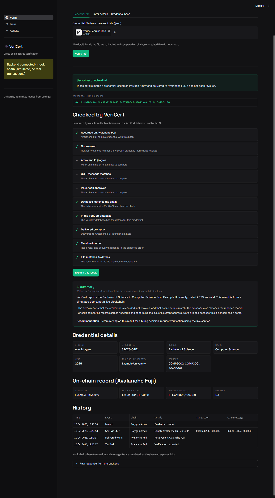
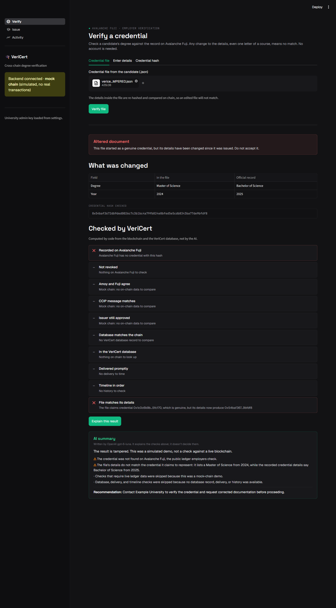
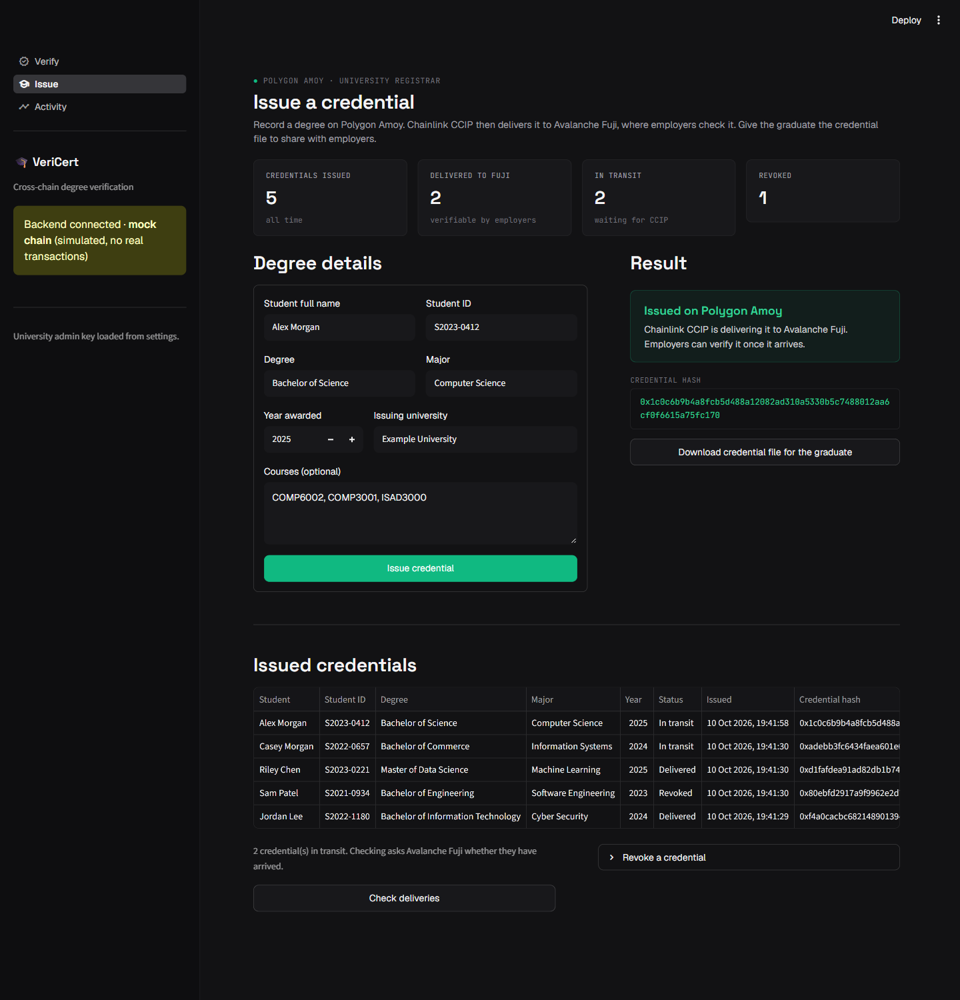
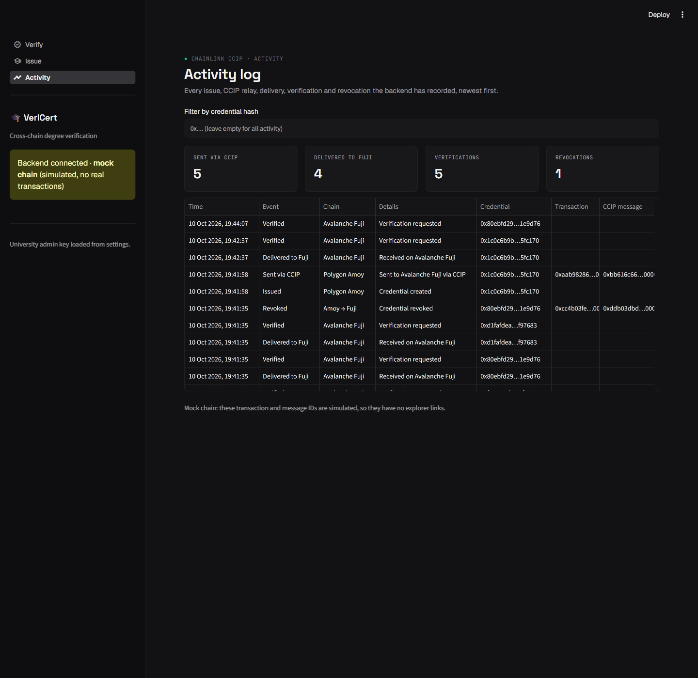
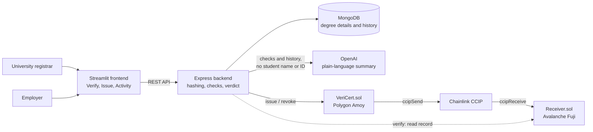

# VeriCert

**Blockchain-enabled cross-chain academic credential verification with AI-generated explanations.**

VeriCert lets a university issue a degree as a tamper-evident record, and lets an employer check that record in seconds without an account or any blockchain knowledge. Change a single letter of a certificate's details and it no longer matches.

[](LICENSE)


Built by Group 15 for COMP6002 (Computer Science Project), Semester 2, 2026.

> [!IMPORTANT]
> **Project status: academic prototype.** The contracts are deployed on the Polygon Amoy and Avalanche Fuji testnets (see [Deployed contracts](#deployed-contracts)). The full workflow has been tested in mock mode and against the real contracts on a local Hardhat chain, with Chainlink Local simulating CCIP. This repository doesn't yet include a recorded delivery across the public testnets. The app runs locally, isn't hosted online, and is not intended for production.

## Contents

- [Screenshots](#screenshots)
- [Features](#features)
- [How it works](#how-it-works)
- [Tech stack](#tech-stack)
- [Project structure](#project-structure)
- [Getting started](#getting-started)
- [Configuration](#configuration)
- [Testing](#testing)
- [API reference](#api-reference)
- [Smart contracts](#smart-contracts)
- [Deploying to the testnets](#deploying-to-the-testnets)
- [Security and privacy](#security-and-privacy)
- [Known limitations](#known-limitations)
- [Team](#team)
- [License](#license)

## Screenshots

All screenshots use mock mode and fictional students.

| Genuine credential | Altered document |
|---|---|
|  |  |

| University issuing page | Activity log |
|---|---|
|  |  |

## Features

**For employers (no login)**
- Verify a degree in three ways: upload the graduate's credential file, type in the details, or paste a hash.
- Get a clear verdict: genuine, altered, revoked, still in transit, or not found.
- See exactly which fields were changed on an altered credential file.
- See the ten checks behind the verdict and the credential's full history.
- Click **Explain this result** for a plain-language AI summary.

**For universities (admin key)**
- Issue degrees and download a credential file for each graduate.
- Revoke degrees, with a confirmation step.
- Track credentials as they move from Polygon Amoy to Avalanche Fuji.
- Review every issue, relay, delivery, verification and revocation in an activity log.

**Under the hood**
- Only a fingerprint of each degree goes on chain. Student details stay off chain in MongoDB.
- Fixed code decides every verdict. The AI only explains it.
- A credential with a revocation still in transit is already reported as not valid.
- A mock chain lets you run everything without a wallet or test tokens.

## How it works

The core design idea is to treat the blockchain as a tamper-proof database of hashes, and keep all data handling and user interaction in ordinary web services.



### Issuing and verifying

1. **Issue.** The backend normalises the degree details, hashes them with SHA-256, and saves the details in MongoDB. It then calls `VeriCert.issue(hash)` on Polygon Amoy.
2. **Relay.** The issuing wallet attaches the CCIP fee in POL, and `VeriCert` sends the hash to Avalanche Fuji and refunds any overpayment. The credential shows as `relaying` until it arrives. Testnet delivery is estimated at 5 to 25 minutes.
3. **Receive.** `Receiver` accepts the message only if it comes through the Chainlink router, from Amoy, and from the trusted `VeriCert` address.
4. **Verify.** The employer submits the graduate's details. The backend re-hashes them itself and looks the result up on Fuji. Any altered detail produces a different hash, so there is no match.
5. **Explain.** Code checks produce the verdict immediately. An AI summary is generated only if the user asks for one.

Revocation follows the same path. If a revocation message overtakes its issue message, `Receiver` still keeps the credential revoked.

### Hashing

Text is trimmed, repeated spaces are collapsed, everything is lowercased, and courses are sorted. The result is serialised as JSON and hashed with SHA-256. So `Computer Science` and `computer  science` give the same hash, while `Master` instead of `Bachelor` does not.

### Verdicts

Verdicts are decided in this order of priority:

| Verdict | Meaning |
|---|---|
| `tampered` | A credential file names a genuine credential, but its details no longer produce that hash |
| `relaying` | Issued, and still travelling to Avalanche Fuji |
| `revoked` | The university cancelled it, including a revocation still in transit |
| `not_found` | No such credential was issued |
| `valid` | It exists on Fuji and has not been revoked |

Typing altered details by hand gives `not_found`, because there is no claimed hash to compare against. Only an uploaded credential file can be identified as `tampered`.

### The ten checks

| # | Check | When it fails |
|---|---|---|
| 1 | Recorded on Avalanche Fuji | Critical (warning while still relaying) |
| 2 | Not revoked | Critical |
| 3 | Amoy and Fuji agree (live mode) | Critical |
| 4 | CCIP message matches (live mode) | Critical |
| 5 | Issuer still approved (live mode) | Warning |
| 6 | Database matches the chain | Critical |
| 7 | In the VeriCert database | Warning |
| 8 | Delivered within 30 minutes | Warning |
| 9 | Timeline in order | Critical |
| 10 | File matches its details (uploaded file only) | Critical |

Checks that have nothing to examine are marked as skipped. For example, checks 3 to 5 are skipped on the mock chain.

### AI explanations

The model receives the verdict, the checks and the history, and it can't change the result. Controls in place:

- Student names and IDs are never sent to OpenAI, and requests use `store: false`.
- Credential data is passed as data, not instructions, as a defence against prompt injection.
- Answers are cached in MongoDB, so an unchanged case isn't paid for twice.
- New summaries are limited to 10 per minute per IP address and `AI_DAILY_LIMIT` per day across the server.
- Without an API key, or if OpenAI fails, verification still works and only the summary is unavailable.

### Chain modes

`CHAIN_MODE` in `backend/.env` selects one of two implementations behind the same interface:

| Mode | What it uses | Delivery | Needs |
|---|---|---|---|
| `mock` (default) | A local JSON file standing in for both chains | Instant | Nothing extra |
| `ccip` | The real contracts, through ethers.js | Minutes | Deployed contracts and an approved issuer wallet holding POL |

## Tech stack

| Layer | Technology |
|---|---|
| Frontend | Python, Streamlit, requests, pandas |
| Backend | Node.js, Express 5, ethers.js 6 |
| Database | MongoDB with Mongoose (`mongodb-memory-server` for local runs and tests) |
| Contracts | Solidity 0.8.24, Hardhat 2, OpenZeppelin Contracts 5 |
| Cross-chain | Chainlink CCIP, with Chainlink Local as the test simulator |
| Networks | Polygon Amoy (chain ID 80002), Avalanche Fuji (chain ID 43113) |
| AI | OpenAI Responses API, default model `gpt-6-luna` |

## Project structure

```text
VeriCert/
├── backend/
│   ├── server.js            # Express routes
│   ├── credential.js        # Validation, normalisation and SHA-256 hashing
│   ├── verification.js      # Combines chain and database state
│   ├── db.js                # Mongoose models
│   ├── ai/                  # Evidence, code checks, prompt and OpenAI client
│   ├── chain/               # mock and ccip implementations
│   ├── scripts/             # local runner, end-to-end demo, live smoke test
│   └── test/
├── contracts/
│   ├── contracts/           # VeriCert.sol (Amoy) and Receiver.sol (Fuji)
│   ├── scripts/             # Deployment and Remix flattening
│   ├── test/
│   └── DEPLOYMENT.md        # Step-by-step testnet guide
├── frontend/
│   ├── app.py               # Streamlit entry point
│   ├── api.py               # Backend client
│   ├── verdict.py           # Maps API answers to displayed verdicts
│   ├── credential_file.py   # Credential file format
│   ├── theme.py             # Styling
│   ├── views/               # Verify, Issue and Activity pages
│   └── tests/
└── assets/screenshots/
```

## Getting started

These steps run the whole app locally in mock mode. You don't need a wallet, test tokens, an OpenAI key or a MongoDB installation.

### Prerequisites

- [Node.js](https://nodejs.org) 20.19 or newer
- [Python](https://www.python.org) 3.10 or newer
- [Git](https://git-scm.com)

The project was developed on Node.js 24 and Python 3.14 on Windows.

### 1. Clone the repository

```bash
git clone https://github.com/ashutoshsati/VeriCert---Blockchain-Enabled-Cross-Chain-Academic-Credential-Verification-with-AI-insights.git VeriCert
cd VeriCert
```

### 2. Start the backend

```bash
cd backend
npm install
cp .env.example .env
```

On Windows Command Prompt, use `copy .env.example .env` instead of `cp`.

Generate an admin key:

```bash
node -e "console.log(require('crypto').randomBytes(32).toString('hex'))"
```

Paste the result into `backend/.env` as the value of `ADMIN_API_KEY`, then start the server:

```bash
npm run local
```

`npm run local` starts a bundled MongoDB as well as the API, and keeps its data in `backend/local-data/`. The first run downloads the MongoDB binary, which can take a few minutes. The API is ready when it prints `Server running on http://localhost:3000`.

If you already run MongoDB, set `MONGODB_URI` in `.env` and use `npm start` instead.

### 3. Start the frontend

In a second terminal, from the repository root:

```bash
cd frontend
python -m venv .venv
```

Activate the virtual environment:

```bash
# Windows PowerShell
.venv\Scripts\Activate.ps1

# macOS or Linux
source .venv/bin/activate
```

Then install the dependencies and start the app:

```bash
pip install -r requirements.txt
streamlit run app.py
```

Open http://localhost:8501. The sidebar should show **Backend connected · mock chain**.

### 4. Try it

1. On the **Issue** page, paste your `ADMIN_API_KEY` into the sidebar.
2. Fill in the form, select **Issue credential**, and download the credential file.
3. On the **Verify** page, upload the file. It should show **Genuine credential**.
4. Open the file in a text editor, change the year, and upload it again. It should show **Altered document** and list the change.
5. Revoke the credential on the **Issue** page and verify it again. It should show as revoked.

### Optional: AI summaries

Add your key to `backend/.env` and restart the backend:

```env
OPENAI_API_KEY=your-key-here
```

### Optional: terminal demo with the real contracts

This deploys both contracts to a temporary local Hardhat chain, with Chainlink Local simulating CCIP, and walks through issuing, tampering and revoking. It needs no wallet or test tokens.

```bash
cd contracts
npm install
npm run compile
cd ../backend
npm run demo
```

## Configuration

### Backend (`backend/.env`)

| Variable | Required | Description |
|---|---|---|
| `MONGODB_URI` | With `npm start` | MongoDB connection string. `npm run local` sets its own |
| `PORT` | No | API port. Default `3000` |
| `ADMIN_API_KEY` | Yes | Secret for admin routes, sent as the `x-api-key` header |
| `CHAIN_MODE` | No | `mock` (default) or `ccip` |
| `MOCK_CHAIN_FILE` | No | Mock chain state file. Default `backend/mock-chain.json` |
| `AMOY_RPC_URL` | In `ccip` mode | Polygon Amoy RPC endpoint |
| `FUJI_RPC_URL` | In `ccip` mode | Avalanche Fuji RPC endpoint |
| `ISSUER_PRIVATE_KEY` | In `ccip` mode | Key of an approved issuer wallet. Use a testnet-only wallet |
| `VERICERT_ADDRESS` | In `ccip` mode | `VeriCert` contract address on Amoy |
| `RECEIVER_ADDRESS` | In `ccip` mode | `Receiver` contract address on Fuji |
| `OPENAI_API_KEY` | No | Enables AI summaries |
| `OPENAI_MODEL` | No | Default `gpt-6-luna` |
| `AI_DAILY_LIMIT` | No | New AI summaries per day across the server. The example file sets `500` |

Use a separate database for each chain mode, for example `vericert-ccip` for `ccip`. Records made in one mode don't exist in the other. `npm run local` handles this for you.

### Frontend

Set these as environment variables or in `frontend/.streamlit/secrets.toml`, using `secrets.toml.example` as a template. All are optional.

| Variable | Description |
|---|---|
| `VERICERT_API_URL` | Backend address. Default `http://localhost:3000` |
| `VERICERT_ADMIN_KEY` | Admin key, so you don't have to type it into the sidebar |
| `VERICERT_ISSUER_NAME` | Pre-fills the issuing university on the form |

## Testing

| Suite | Command | Passing tests |
|---|---|---|
| Smart contracts | `cd contracts && npm test` | 26 |
| Backend | `cd backend && npm test` | 81 |
| Frontend logic | `cd frontend && python -m unittest discover -s tests -t .` | 22 |
| **Total** | | **129** |

Compile the contracts before running the backend tests. Otherwise the backend suite skips its tests against the real contracts:

```bash
cd contracts && npm install && npm run compile
```

The tests cover duplicate and unauthorised issuing, rejected cross-chain senders, out-of-order delivery, revocation, altered files, and error handling. They also check that student names and IDs never reach OpenAI. The test suites make no real OpenAI or public testnet calls.

## API reference

The base URL is `http://localhost:3000`. Admin routes need an `x-api-key` header matching `ADMIN_API_KEY`.

| Method | Route | Access | Purpose |
|---|---|---|---|
| `GET` | `/health` | Public | Server status and chain mode |
| `POST` | `/issue` | Admin | Issue a credential |
| `POST` | `/revoke/:hash` | Admin | Revoke a credential |
| `POST` | `/verify` | Public | Verify by credential details |
| `GET` | `/verify/:hash` | Public | Verify by hash |
| `POST` | `/explain` | Public | Verdict, checks and optional AI summary |
| `GET` | `/credentials?limit=` | Admin | Latest credentials (limit 1 to 200, default 50) |
| `GET` | `/events?limit=&hash=` | Admin | Event log, newest first (limit 1 to 200, default 50) |

### Issue a credential

```bash
curl -X POST http://localhost:3000/issue \
  -H "Content-Type: application/json" \
  -H "x-api-key: YOUR_ADMIN_API_KEY" \
  -d '{
    "studentName": "Alex Morgan",
    "studentId": "S2023-0412",
    "degree": "Bachelor of Science",
    "major": "Computer Science",
    "year": 2025,
    "courses": ["COMP6002", "COMP5001"],
    "issuer": "Example University"
  }'
```

These examples use bash syntax, which works in Git Bash on Windows.

```json
{
  "success": true,
  "credentialHash": "0x097bfb820d5fe57752b1ef349fb403b64a6c89f9b6ca84b580264d7e33dd1da7",
  "status": "relaying",
  "txHash": "0xaa704b13b95911100000000000000000000000000000000000000000000000",
  "ccipMessageId": "0xbb2cfaa2b916d3e00000000000000000000000000000000000000000000000"
}
```

The transaction and message IDs above are simulated values from mock mode.

Other responses: `400` for invalid details or a year after the current one, `401` for a wrong or missing key, and `409` if the credential already exists.

### Verify a credential

`POST /verify` takes the same seven fields. `GET /verify/:hash` takes a hash.

```bash
curl http://localhost:3000/verify/0x097bfb820d5fe57752b1ef349fb403b64a6c89f9b6ca84b580264d7e33dd1da7
```

```json
{
  "credentialHash": "0x097bfb82...",
  "verification": {
    "found": true,
    "isValid": true,
    "issuer": "Example University",
    "issuedAt": 1794223530124,
    "receivedAt": 1794223530124,
    "revoked": false
  },
  "metadata": { "studentName": "Alex Morgan", "status": "active" },
  "provenance": [{ "eventType": "issued", "chain": "polygon-amoy" }]
}
```

This response is shortened. Possible status codes:

| Status | Meaning |
|---|---|
| `200` | Found. Check `verification.isValid`, which is `false` for a revoked credential |
| `202` | Issued, and still waiting for CCIP delivery |
| `400` | Invalid details or hash |
| `404` | Not found on chain |

### Explain a result

Send either `hash` or the credential details, not both. `ai` defaults to `true`. Set it to `false` to get the verdict and checks without calling OpenAI. `claimedHash` is the hash written in a credential file, and it's what allows a `tampered` verdict.

```bash
curl -X POST http://localhost:3000/explain \
  -H "Content-Type: application/json" \
  -d '{
    "studentName": "Alex Morgan",
    "studentId": "S2023-0412",
    "degree": "Bachelor of Science",
    "major": "Computer Science",
    "year": 2021,
    "courses": ["COMP6002", "COMP5001"],
    "issuer": "Example University",
    "claimedHash": "0x097bfb820d5fe57752b1ef349fb403b64a6c89f9b6ca84b580264d7e33dd1da7",
    "ai": false
  }'
```

The response contains `credentialHash`, `verdict`, `checks`, `fieldChanges`, `explanation`, `explanationUnavailable`, `evidence`, `model`, `generatedAt` and `cached`.

### Credential file format

Graduates receive this file, and employers upload it on the Verify page:

```json
{
  "format": "vericert-credential",
  "version": 1,
  "credential": {
    "studentName": "Alex Morgan",
    "studentId": "S2023-0412",
    "degree": "Bachelor of Science",
    "major": "Computer Science",
    "year": 2025,
    "courses": ["COMP6002", "COMP3001", "ISAD3000"],
    "issuer": "Example University"
  },
  "credentialHash": "0x1c0c6b9b4a8fcb5d488a12082ad310a5330b5c7488012aa6cf0f6615a75fc170"
}
```

The server always re-hashes the details. It uses the hash written in the file only to detect tampering.

## Smart contracts

### `VeriCert.sol` on Polygon Amoy

The issuer registry and source of truth.

| Function | Access | Purpose |
|---|---|---|
| `issue(hash)` | Approved issuers | Records a credential and relays it to Fuji |
| `revoke(hash)` | Approved issuers | Revokes a credential and relays that to Fuji |
| `quoteFee(action, hash)` | Public | Returns the CCIP fee in POL |
| `getCredential(hash)` | Public | Returns the stored record |
| `addIssuer`, `removeIssuer` | Owner | Manage approved issuer wallets |
| `setReceiver`, `setGasLimit` | Owner | Configure the relay |

Each CCIP fee is paid in native POL by the wallet calling `issue` or `revoke`, and the contract refunds anything above the exact fee. The fee was quoted at about 1.2 POL per message on Amoy. The backend sends 10% extra to allow for fee changes.

### `Receiver.sol` on Avalanche Fuji

The copy that verification reads from.

| Function | Access | Purpose |
|---|---|---|
| `ccipReceive(message)` | CCIP router only | Stores issue and revoke messages |
| `getCredential(hash)` | Public | Returns the stored record |
| `setAllowedSender(sender)` | Owner | Sets the trusted `VeriCert` address |

On chain, a credential is the SHA-256 hash, the issuing wallet address, timestamps and a revoked flag. No names, student IDs or degree details are stored there.

Contracts compile with Solidity 0.8.24, the optimizer at 200 runs, and EVM version `paris`.

### Deployed contracts

Syed Omar Feroz deployed the team's contracts. Both have the same address because the same wallet deployed them on each network.

| Contract | Network | Address |
|---|---|---|
| `VeriCert` | Polygon Amoy (80002) | [`0x0bf93d598B2A16dbD49E8cD079f5257CAeA11a99`](https://amoy.polygonscan.com/address/0x0bf93d598B2A16dbD49E8cD079f5257CAeA11a99) |
| `Receiver` | Avalanche Fuji (43113) | [`0x0bf93d598B2A16dbD49E8cD079f5257CAeA11a99`](https://testnet.snowtrace.io/address/0x0bf93d598B2A16dbD49E8cD079f5257CAeA11a99) |

## Deploying to the testnets

The team's contracts are already deployed, so you only need this section to deploy your own copy. Issuing through a copy requires your wallet to hold POL for the CCIP fee.

[contracts/DEPLOYMENT.md](contracts/DEPLOYMENT.md) has the full guide, including faucets, Remix steps, network addresses and troubleshooting. In short:

```bash
cd contracts
npm install
cp .env.example .env     # add a testnet-only DEPLOYER_PRIVATE_KEY
npm run deploy:testnets  # deploys and connects the contracts
```

Copy the printed addresses into `backend/.env`, set `CHAIN_MODE=ccip`, and run the smoke test. It issues a throwaway hash and waits for it to reach Fuji:

```bash
cd backend
npm run smoke:ccip
```

If CCIP is slow or testnet funds run out, switch back to `CHAIN_MODE=mock`.

> [!CAUTION]
> Only use a wallet that holds testnet tokens. Never commit a `.env` file or private key.

## Security and privacy

- **Personal data stays off chain.** Only the hash, wallet address, timestamps and revoked flag are written to the blockchain.
- **Admin routes are key-protected,** and keys are compared in constant time.
- **Public routes hide internal errors,** so configuration details can't leak through `/verify`.
- **Cross-chain messages are restricted** to the CCIP router, the Amoy chain and the trusted `VeriCert` address.
- **Chain writes are simulated before sending,** so a transaction that would fail doesn't waste gas.
- **The AI can't affect the verdict,** and never receives student names or IDs.

## Known limitations

- **No recorded live delivery.** The automated tests use a simulator for cross-chain delivery, and no public testnet run is recorded here, so delivery times are estimates, not measurements.
- **High testnet fees.** Each issue or revoke costs about 1.2 POL in CCIP fees on Amoy.
- **Open verification data.** `/verify` returns the stored details, including the student's name, to anyone who has the hash or the full details.
- **Unsalted hashes.** Someone who can guess all of a person's details could compute the hash.
- **Single admin key.** There are no per-university accounts or wallet sign-in.
- **Revocation gap.** The database is marked revoked only after the Amoy transaction confirms. The "Database matches the chain" check detects a mismatch.
- **Limited recovery window.** Recovering a transaction with a lost response searches only about the last 50,000 Amoy blocks.
- **Partial smoke test.** `npm run smoke:ccip` covers issuing, not revoking.
- **No usability study.** The usability evaluation proposed for the project was not carried out.

## Team

**Group 15, COMP6002 Computer Science Project, Curtin University, Semester 2, 2026**

| Member | Focus |
|---|---|
| Ashutosh Sati | Chainlink CCIP integration and Streamlit interface |
| Md Solaiman Hossain | Credential data modelling and Solidity contracts |
| Syed Omar Feroz | Backend APIs, testing workflows and testnet deployment |
| Ramal Jayaweera | AI explanations and project documentation |

Supervisor: Prof. Sajib Mistry

## License

Released under the [MIT License](LICENSE).
